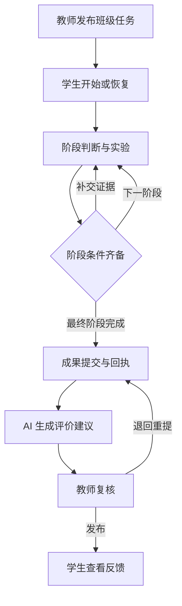

# suxin AI 实验教学平台开发与验收规格

版本 1.0 · 2026 年 11 月 25 日 · 适用对象为学校项目负责人、Codex 开发及验收人员

本文件可单独交给 Codex 开发。平台用于把教师的实验任务、学生判断、多智能体协作、实验结果、成果提交和教学评价串成一条可追溯的流程。首个可运行版本使用本地演示账号、合成数据和可替换的模型模拟器。学校身份系统、模型密钥、真实设备或更多参考资料到位后可按接口接入。

## 1. 参考调研与学校版决策

| 功能 | 邮百工现场证据 | 学校版规格 |
| --- | --- | --- |
| 课程首页与路径 | 已实测试用课程、分类与学习路径切换、加入课程提示、统计空状态 | F01、F02 |
| 综合训练 | 已实测流程搜索与空结果。已观察阶段、资源版本、工程团队、专家团队及文档推进提示 | F03、F04 |
| 专项训练与专家研讨 | 已展开专项目录。已观察研讨类型、议题输入和记录入口 | F06、F07 |
| 团队协作 | 已实测模板筛选与加入列表。未创建房间 | F08 |
| 远程实验和绘图 | 已实测实验员分类到设备列表。已观察设备状态和绘图输入入口 | F09、F10 |
| 成果、记录、评价 | 已实测作业排序与状态筛选。已观察存档搜索及恢复入口、报告空状态。未完成作业提交、评分和存档恢复 | F04、F05 |
| 教师和管理员 | 已验证独立教师管理登录页。内部页面及权限未验证 | F11、F12 |

F01–F12 均为学校版规格。学校版使用原创页面、文字、实验及评价量规。上表的证据等级用于研判参考，不影响按本规格开工。具体实现以本文件为准。

## 2. 开发环境和默认配置

| 项目 | 实施默认值 |
| --- | --- |
| 代码和环境 | 初始化独立 Git 仓库。应用、数据和部署配置限定在 suxin 项目。 |
| 技术栈 | TypeScript、Next.js App Router、PostgreSQL、Prisma。用独立 Node worker 执行模型、评价、模拟实验。使用数据库 durable job queue 与轮询或 SSE 返回状态。 |
| 启动方式 | Docker Compose 提供 web、worker、db 和演示文件卷。提供 .env.example、lockfile、迁移、种子及 README。约定 `docker compose up --build` 可启动，README 给出迁移、播种及测试的准确命令。 |
| 认证 | 本地账号基线，密码哈希，服务端会话和安全 Cookie。无校园认证资料时用本地登录。通过 provider 接口预留 OIDC，学校正式接入前关闭演示凭据。 |
| 模型 | 内置确定性模拟器，按输入生成结构化演示回复。真实模型通过服务端适配器和环境变量配置，可按环境设置模型、超时、额度与上下文预算。 |
| 附件 | 实施本地私有卷与存储接口，生产可切对象存储。初始允许 PDF、PNG、JPEG、TXT、CSV、MD，单文件 10 MB，每次提交最多 5 个。服务端查大小、扩展名与实际内容，下载先鉴权。 |
| 界面和时间 | 中文、桌面优先、自适应。展示默认 Asia/Shanghai，数据库存 UTC。界面用任务列表、分步编辑表单和实验工作区，含加载、空态、错误和成功提示。 |
| 环境开关 | 演示种子仅在开发环境显式启用。默认不连接真实模型、校园认证或硬件，可在断开外部服务的环境中完成主线验收。 |

## 3. 角色与数据范围

所有业务查询按组织和所属对象授权。服务端同时校验组织、课程或班级成员关系、所有权和状态。不可见资源返回统一 404。已知资源的越权操作返回 403。附件、历史、评价、SSE 和后台任务都使用同等范围校验。

| 角色 | 查看范围 | 可用动作 | 限制 |
| --- | --- | --- | --- |
| 学生 | 本人所在班级的已发布任务、本人或被授权小组记录、已发布反馈 | 开始、继续、对话、记录决定、实验、提交、重提 | 其他班级或小组、评分草稿、教师区 |
| 教师 | 自己任教或获授权的课程、班级、实验及交付物 | 设计模板、预览、发布、调截止、退回、复核和发布评价 | 跨班级授权由成员关系决定 |
| 助教 | 被授权班级的教学内容与待阅记录 | 浏览、批注、起草评价 | 正式反馈发布由教师完成 |
| 组织管理员 | 所属组织的成员、班级分配、角色、配置、运维状态及审计摘要 | 邀请或停用账号、分配角色、管理配置 | 学生对话、作业正文和个人反馈默认按教学授权控制 |
| 智能体和后台任务 | 指定训练、阶段及任务的已授权上下文 | 生成建议、调用获准工具、写入任务或运行结果 | 无人类账号权限，不能自行提交、改分、发反馈或推进阶段 |

成员调离、账号停用和角色撤销后，下一次请求即按新权限执行。后台任务开始前和提交结果前都复核所属组织、会话及目标状态。审计保留历史操作人标识。

## 4. 页面与功能目录

字段名是学校版设计，可按阅读顺序重新排版。关键写入返回操作结果或明确的业务错误。

| 编号 | 路由与页面 | 主要字段及操作 | 输出和前提 |
| --- | --- | --- | --- |
| F01 | /login、/app | 用户名、密码、退出、个人工作台 | 登录建立会话。按角色显示课程、教师工作台、管理入口。失效转回登录。 |
| F02 | /app/courses、/app/courses/:id | 课程名称、班级、训练路径及进度、分类、任务到期、搜索、排序、状态筛选。班级码使用前预览课程和班级 | 试用资源与正式课程分区，试用不计正式作业。班级码仅开放加入期间可用，已加入时返回现有成员记录。 |
| F03 | /app/assignments/:id、/app/runs/:id | 任务目标、任务约束、阶段说明、当前阶段、可用角色、阶段产物、证据、开始或继续 | 个人任务每人每任务一个正式实例。小组任务每组一个正式实例。练习实例可重开，同一时间只保留一个可继续的实例，历史仍可读。 |
| F04 | /app/runs/:id | 角色选择、文本对话、附件、运行状态、判断理由、证据引用、阶段文档、历史和恢复 | SSE 或轮询输出模型进度。阶段完结产生快照。刷新后从服务端恢复本人可见的项目状态。 |
| F05 | /app/runs/:id/submission、/app/feedback/:id | 文本、附件、提交确认、回执、版本、反馈、退回理由 | 提交以服务器时间为准，退回后可按策略重提。学生可看已发布反馈和自己的提交历史。 |
| F06 | /app/skills | 分类、名称、课程范围、公开或课程专区、开始专项练习 | 一名学习者与一个角色完成一个短练。可保存结构化小成果，课程作业和练习分开。 |
| F07 | /app/discussions | 研讨类型、主题、约束、背景、选择讨论轮次、历史 | 输入非空主题后生成专家角色和分立意见。记录分歧、建议及学生的最终取舍。 |
| F08 | /app/teams | 模板、成员范围、人数、房间列表或邀请口令、主持人、历史与只读展示 | 房主负责准备与启动，阶段讨论同时面向学生和预设 AI。加入前检查课程范围、容量和房间状态。 |
| F09 | /app/labs | 实验目录、设备状态、参数表单、任务进度、输出与操作日志 | 模拟实验返回结果文件或结构化数据。设备界面可展示空闲、忙碌、离线，真实设备适配器默认关闭。 |
| F10 | /app/drawing | 图种、文本说明、预览、下载、关联到阶段产物 | 默认支持确定性流程图与架构图示例，生成结构化节点和边并渲染。模型和图片解析按同一接口扩展。 |
| F11 | /teach/courses、/teach/templates/:id、/teach/assignments/:id、/teach/reviews/:id | 管理课程与班级、编辑任务模板、预览、发布、成员与进度、作业队列、证据、量规、复核 | 教师草稿可保存，发布生成不可变模板版本。学生预览使用测试实例。课程发布、成绩发布和归档均记录操作人。 |
| F12 | /admin/users、/admin/scopes、/admin/audit、/admin/settings | 账号状态、角色及范围、课程成员分配、动作筛选、模型与存储健康、队列状态 | 展示操作摘要、时间与对象标识。敏感内容按课程授权控制，审计页不展示密码、密钥和模型输入原文。 |

## 5. 教师配置表单及规则

| 对象 | 必填与可选字段 | 保存和发布条件 |
| --- | --- | --- |
| 课程 | 名称、课程代码、负责人。描述与封面可选。 | 课程代码为组织内唯一；学期与班级创建后可绑定任务。 |
| 班级 | 课程、名称、学期、教师。可选助教、加入码、开始和截止时间。 | 加入码限定单一班级，可失效；学生通过班级成员关系获得任务访问。 |
| 模板版本 | 名称、类型、目标、场景、至少一个阶段、至少一个学生可见角色。可选材料、约束。 | 草稿可修改。发布时校验引用完整、阶段顺序、必需角色和工具配置。版本发布后不可变。 |
| 阶段 | 标题、顺序、目标、学生要回答的问题、产物要求。可选阶段前置条件、必需角色咨询、模拟实验和文件。 | 阶段推进前按版本化规则核对判断字段、附件、实验或咨询证据。没有权限或缺条件时不推进。 |
| 智能体角色 | 名称、职责、允许阶段、可读上下文、角色指令版本、可调用工具。 | 角色输入来源必须在白名单。角色的生成结果经结构化校验。角色配置不授予用户权限。 |
| 量规 | 维度、说明、分档、权重与可引用的证据类型。 | 至少一个维度，权重合计 100，分数使用 0–100。发布后与任务绑定，更新开新版本。 |
| 班级任务 | 班级、实验模板版本、量规版本、个人或小组、开放时间、截止时间、允许迟交和重提策略。 | 截止晚于开放时间。发布后模板、量规及任务类型固定，调整截止保存前后值。默认不迟交，允许教师明确退回后重提。 |

## 6. 状态流转与操作规则

| 对象 | 状态与转换规则 |
| --- | --- |
| 模板 | 草稿 → 已发布 → 已归档。归档停止新任务选择，已有任务可继续查看。已发布模板编辑生成新草稿。 |
| 班级任务 | 草稿 → 已发布 → 已关闭 → 已归档。开放时间之前不可开始。截止后是否可交由策略决定。关闭后仍保留已有记录，教师可评阅。 |
| 训练 | 进行中 → 待提交 → 已提交 → 已退回或已评价。已退回可回到待提交并形成新版本。试用训练独立为进行中、已完成、已归档。 |
| 评价 | 待处理 → AI 建议可用或 AI 建议失败 → 人工草稿 → 已发布。AI 失败时允许人工完成。已发布评价如需修订创建新版本，记录修订人和时间。 |
| 团队房间 | 等待 → 进行中 → 已完成或取消。房主启动前校验人数；运行中的成员变化采用明确授权或拒绝。 |
| 模型和实验任务 | 排队 → 执行中 → 成功、失败或取消。后台任务超时释放资源，已确认的产物只写入一次。 |

阶段规则由服务端计算。学生输入首先记录为消息，再创建后台任务；流式展示中断后可从已持久化的最后序号重新订阅。后台错误保留用户输入，提供可重试状态。教师关闭任务或管理员撤销权限，应阻止新的操作。提交、阶段推进、评价发布及硬件租约用事务与唯一约束控制并发；重复请求须返回同一结果或清晰冲突。

## 7. 智能体、工具与评价

1. **综合训练**。主持器以阶段和模板版本决定可选角色。导师追问依据，情境角色表达目标与约束，技术角色检查可行性，评审角色用量规整理证据。选一个角色发送时只调用该角色。其他角色由预设流程或用户选取触发。学生以独立字段记录最终判断和理由。
2. **专项训练**。单智能体以一个明确能力目标组织短练，产物绑定练习实例和角色版本。首批模板为问题拆解、实验假设设计、结果解读。
3. **专家研讨**。按议题生成三位结构化专家。每位专家含职责、关注点、质疑、建议。默认单轮，界面保留各方意见和学生选择。生成失败可重试同一轮。
4. **团队训练**。成员消息、主持阶段、智能体回复使用统一序号。主持人可向允许的角色提问和确认小组结论。其他成员可贡献证据。最终提交采用房主或教师指定提交人的规则。
5. **模拟实验**。先提供可回放的噪声采样模拟，输入采样时长、位置和条件，输出合成 CSV、摘要和可视化。工具使用参数 schema、超时、资源限额和可见范围。真实设备由学校接入适配器后启用，通过明确操作确认、设备租约和命令白名单运行。
6. **评价**。结构化结果至少有量规维度、建议分、引用证据 ID、理由、改进项和置信说明。服务端拒绝当前训练范围外的引用。正式反馈仅由获授权教师发布，发布前学生可见提交状态，发布后看到维度反馈和可见证据。
7. **绘图**。先支持节点与边的自定义结构，经 schema 确认后渲染，图形源文件与版本储存到当前训练。上传参考图用于生成的能力可待真实模型接入后验收。
8. **模型边界**。消息和上传文本按数据处理。组织和会话访问范围由服务端构造。真实模型适配器配置每次调用的超时和预算，默认使用最小上下文。保存角色提示版本、模型、耗时、使用量、结果状态及证据引用。日志正文按组织配置期限清理，保留审计摘要。

## 8. 数据模型和一致性

全部业务对象统一使用 UUID，包含组织 ID、创建时间。所有可修改对象加 updated_at，关键状态对象加 revision。外键和复合索引应在数据库层检查组织一致性。能力分数、反馈、文件和运行状态以相应业务主表为准，列表统计可按主表重新计算。

| 实体 | 最小字段与主关系 |
| --- | --- |
| Organization、User、Membership | 组织、账号、启用状态、会话、角色、范围。唯一登录名在组织内有效。 |
| Course、Class、Enrollment | 课程代码、班级学期、任教或学员关系。唯一 class_id + user_id + role。 |
| Template、TemplateVersion、StageSpec、AgentRoleVersion、RubricVersion | 版本号、类型、顺序、发布人、阶段条件、角色上下文和量规 JSON。版本不可变。 |
| Assignment、Team、TeamMember | 班级、版本绑定、任务类型、时间策略、小组人数、房主、成员和加入状态。 |
| Run、StageRecord、Message、Evidence | 当前阶段、归属、练习类型、运行状态。消息由 run_id + sequence 排序。证据关联消息、阶段产物、设备结果或教师反馈。阶段关闭保存快照。 |
| Submission、SubmissionAttachment、Review | 训练实例、版本、内容、回执、提交人、提交时间、评分草稿、发布人、量规与证据引用。唯一 run_id + version。 |
| StoredFile、Job、Device、DeviceLease、ExperimentResult | 私有对象键、大小、哈希，分配、状态、超时、可选租约、结果文件与参数摘要。 |
| AuditEvent | 组织、操作者、动作、对象类型和 ID、时间、结果、请求标识、最小结构化变化摘要。 |

正式提交、阶段推进和评价发布使用数据库事务。异步操作在同一事务登记业务请求与后台任务，避免出现前台成功但后台漏执行。消息写入带客户端生成的唯一键。重放相同幂等键返回原结果；参数发生变化时返回冲突。上线前按学校要求配置留存、导出与数据删除策略。

## 9. API 实现合同

API 以 `/api/v1` 为前缀，浏览器正常页面通过这些入口使用业务逻辑。写请求使用会话与 CSRF 防护。关键动作带 `Idempotency-Key`。错误统一返回 `{code,message,fieldErrors,requestId}`，列表统一返回 `{items,nextCursor}`。非法输入 400 或 422，冲突 409，未登录 401，授权错误 403 或 404，限流 429。模型和实验的排队任务返回 202 和 jobId。

| 方法与路径 | 输入 | 成功结果 |
| --- | --- | --- |
| POST /auth/login；POST /auth/logout；GET /me | 用户名和密码；退出；读取会话 | 会话与角色范围 |
| GET /courses；GET /classes/:id/assignments；POST /enrollments | 搜索筛选；班级；班级码 | 当前授权对象、加入结果 |
| POST /templates；PATCH /templates/:id/draft；POST /templates/:id/versions | 名称、配置、发布草稿 | 草稿或不可变版本 |
| POST /assignments；POST /assignments/:id/publish；POST /assignments/:id/close | 班级、版本、策略；发布；关闭 | 任务状态、操作时间 |
| POST /assignments/:id/runs；GET /runs/:id | 可选团队；读取本次训练 | 唯一训练实例、阶段与进度 |
| POST /runs/:id/messages；GET /runs/:id/events | 角色、内容、附件、客户端消息 ID；重连序号 | 消息和 jobId；增量事件 |
| PUT /runs/:id/stages/:stageId/draft；POST /runs/:id/stages/:stageId/complete | 判断、理由、证据 ID、产物、revision | 保存结果或缺项清单，成功时返回下一阶段 |
| POST /runs/:id/submissions；GET /runs/:id/submissions | 内容、文件 ID、revision | 提交版本、回执；本人可见历史 |
| POST /submissions/:id/evaluate；PUT /submissions/:id/review；POST /submissions/:id/return；POST /submissions/:id/publish-review | 评价触发、人工分项与证据、退回理由、发布版本 | jobId、草稿、退回或公开回执 |
| POST /files；GET /files/:id/content | 私有附件或授权下载 | 文件 ID 或受保护内容 |
| POST /teams；POST /teams/:id/join；POST /teams/:id/start | 模板、邀请口令、启动 | 房间、成员、启动状态 |
| POST /runs/:id/lab-jobs；POST /runs/:id/drawings；GET /jobs/:id | 实验参数、绘图结构；查询任务 | jobId、结果或错误 |
| GET /admin/audit；PATCH /admin/memberships/:id；GET /health | 审计条件、范围调整、健康检测 | 审计摘要、权限状态、非敏感健康指标 |

专项和研讨可以复用训练及消息 API。演示模式按入口创建相应类型的练习实例。评价发布的正文和证据分开鉴权。私有下载不通过公开静态目录。

## 10. 种子数据和端到端验收

默认提供校内演示组织、两个班级、一名教师、一名助教、两名同班学生、一名异班学生及一名管理员。测试账号只允许在演示环境创建，实际凭据通过本地输出或环境配置获得。

原创实验为“校园教室噪声监测方案”。学生需说明监测目的，选择位置与采样时长，提出判定规则，运行软件模拟并比较两组结果，最后交决策说明和 CSV。量规为问题与约束 25 分、实验设计 25 分、证据解释 30 分、反思 20 分。模拟器固定种子，自动化测试可复现输出。页面明确标示为模拟数据。

| 演示阶段 | 输入 | 推进检查与输出 |
| --- | --- | --- |
| 1 明确问题 | 监测目的、使用者、区域限制 | 输入目的和限制，输出问题陈述 |
| 2 设计方案 | 两个采样位置、时长、判定阈值、向技术角色提问 | 保存可比较的方案，至少一次有效角色回应 |
| 3 模拟与比较 | 每个位置各运行一次，选择两份模拟结果，解释差异 | 两个成功结果和一条数据解释，输出对比证据 |
| 4 决策与反思 | 选择方案、引用结果、说明局限、提出后续动作 | 形成可提交的决策说明与至少一个 CSV 附件 |

| 用例 | 操作 | 必须看到的结果 |
| --- | --- | --- |
| A01 角色登录 | 教师、学生、助教和管理员分别登录 | 工作台按角色展示，退出后旧会话无法访问 |
| A02 教师发布 | 配置四阶段、角色和量规，预览，发布到测试班 | 测试班可见。模板编辑产生新版本，已发布任务绑定原版本 |
| A03 访问隔离 | 异班学生从正常页面访问测试班任务、文件和任务事件 | 三类资源均不可读。助教无正式评价发布权 |
| A04 阶段门槛 | 仅写初步判断，尝试推进；再补角色回应或实验结果 | 缺项时当前阶段保持，齐备后推进并保存快照 |
| A05 会话恢复 | 对话发生后刷新；对同一客户端消息重复发送 | 保留阶段和已确认消息。重复请求只有一条消息及一个后台运行 |
| A06 模型异常 | 模拟一次超时，并点击重试 | 用户输入保留，重试生成一次有效回复，历史可查 |
| A07 双击提交 | 同一提交连续触发两次，再由两标签提交不同版本 | 同键返回同一回执，并发按版本冲突处理，不覆盖历史 |
| A08 人工评价 | AI 建议生成后教师改分并发布 | 反馈发布前学生不可见，发布后仅本人和授权教师可查 |
| A09 退回重提 | 有理由地退回，学生再次提交 | 原回执和内容保留，列表展示最新版本，旧评价仍可审计 |
| A10 截止与禁用 | 提交边界时间测试，再停用账号或撤销成员权限 | 服务端按任务策略判定。旧会话后续操作被拒绝 |
| A11 小组并发 | 建队，两个账号并发加入最后一个名额 | 保证人数上限。无权限成员无法读取房间消息与附件 |
| A12 模拟实验 | 运行模拟器并将 CSV 作为阶段证据 | 结果绑定本次训练，带模拟标记，证据可在评阅页追溯 |
| A13 扩展功能 | 做一次专项、生成三专家研讨、生成流程图、从个人历史打开练习 | 各入口有可重复演示，试用记录与正式任务统计分开 |
| A14 教师后台与审计 | 查找逾期提交、筛选班级、查看某次评价发布 | 统计与作业状态一致。审计仅保留必要的个人信息，能追踪谁何时做了什么。 |

## 11. Codex 执行顺序与完成定义

- 第 1 批完成应用骨架、迁移、种子、角色鉴权、课程及班级、模板预览发布。验收 A01–A03。
- 第 2 批完成完整实验运行、消息、模拟器、阶段校验、提交、回执和评价。验收 A04–A10 及 A12。
- 第 3 批完成专项、专家、团队、绘图、历史、成长反馈及管理台。验收 A11、A13–A14，回归前两批。
- 第 4 批准备真实服务接入接口、设备租约和发布验收说明。校园认证、真实模型或实体设备在提供配置后各自验收，本地演示始终可运行。

完成时交付可启动源码、迁移、原创样例、自动化测试、环境配置样例、角色与路由表、聚焦异常与并发的验收记录。应用须允许一次“教师发布 → 学生训练 → 提交 → 教师反馈 → 学生查阅”完整演示。当前实际未实测的邮百工后台能力不作为复刻验收依据。

### 可直接交给 Codex 的执行指令

> 按《suxin AI 实验教学平台开发与验收规格》在全新的独立工作区和仓库实施 F01–F12。先用本地身份、合成数据、确定性模型与模拟实验跑通主流程。以 A01–A14 作为验收基准，先交付第 1 批并继续完成第 2、3 批。请保存逐批变更和测试证据，锁定模板与量规版本，在服务端验证角色、班级范围和状态，提供可从空数据库启动的 Docker Compose 与 README。学校账号、真实设备与模型接口按适配器预留。使用原创界面和实验内容。范围仅限 suxin 项目。
